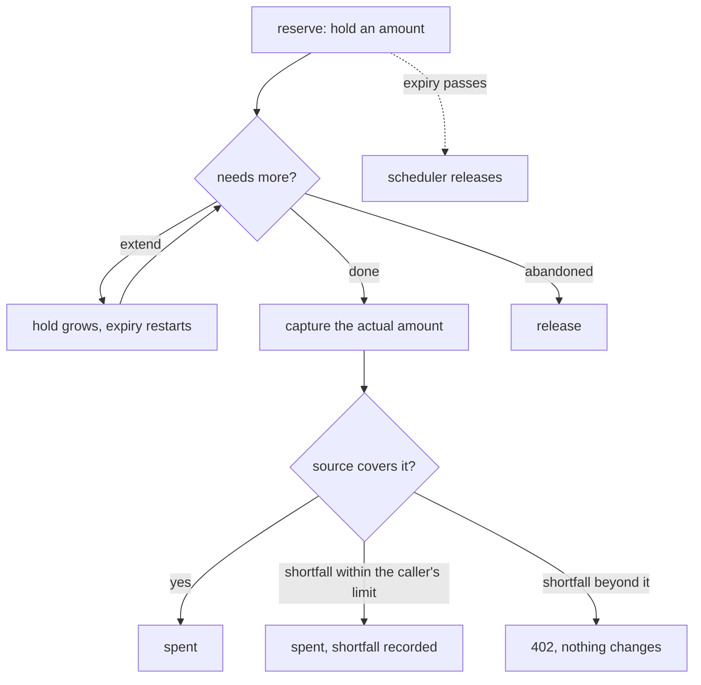

# Membership / Billing — Operations Guide

The membership domain adds subscription + credit plans, a FIFO credit ledger with
reservations, a hybrid entitlement gate, coupons/tax, a PG abstraction (PortOne
V2 first-class), and a background maintenance scheduler.

- Entities: `entity/src/membership/*`; schema in the `membership` migration and the
  `membership_metering` migration after it, which a consumer registers after its other
  migrations
- Services: `api/src/service/membership/*`
- Controllers nest at: `/membership-plans`, `/subscriptions`, `/credits`,
  `/entitlements`, `/membership-purchases`, `/payments`, `/coupons`

This guide covers what an operator must configure before the feature works.

## 1. What has to be granted before the routes answer

`Sumida::new(RULES).router()` nests the routes, but most of them are gated, and a fresh database
holds no grants at all — every protected route refuses until something is seeded. Grants live in
relation tuples and are written through the relation-tuple endpoint. [`docs/permissions.md`](permissions.md)
is the reference for the three tiers, the subject notations and how granting is itself authorized;
this section names only what the membership domain asks for.

### The plan catalogue — a route gate

Plan management is gated on the `membership_plan` namespace. Nothing in it is scoped per row: the
row permission resolves straight back to the namespace's **operator tier**, so a plain-tier grant
opens the route and the list still comes back empty. Grant the operator tier to whoever manages the
catalogue.

```
service:membership_plan#operator@role:7#member   네 동작 전부
service:membership_plan#op_read@role:8#member    목록만
```

Creating is the exception in the other direction — there is no row yet to judge, so the gate is the
whole of it and `service:membership_plan#create` is enough on its own.

### An organization's subscriptions and credit — a relation on the organization

Both are scopes on `organization`, and they carry the containment the other scopes do:
`viewer` < `editor` < `manager`. There is no route gate for either — the row scope is the whole of
it, and it reaches the descendants of the organization it is granted on.

```
organization:42#subscription_manager@role:9#member   구독 관리
organization:42#credit_manager@role:9#member         크레딧 관리
organization:42#credit_editor@user:5                 쓸 수는 있으나 정책은 못 바꾼다
```

Credit carries one branch the other scopes do not: **being a member of the organization is enough to
see its credit**, because spending is authorized against the wallet's own organization and a member
who may spend must be able to read the balance.

An organization's own manager (`organization:42#manager`) implies both, as it implies every other
scope on that organization.

### Personal subscriptions and credit

Nothing to grant for using them. The owner is the session user and the rule reads it off the row:
the owner subscribes, reads the balance and the ledger, spends, holds, extends, captures and
releases on their own wallet.

**A priced period is bought, never asked for.** `POST /subscriptions` takes no payment, so it starts
only a period that costs nothing — a free plan, a free trial, or a first period a coupon covers whole.
Renewing or reactivating a priced subscription by hand, and an upgrade whose difference no stored
billing key pays, are refused with 402 alike. An owner buys a priced period through checkout; the
scheduler renews it by charging the stored billing key. A platform administrator may still do any of
these by hand, and server code that settles the money itself uses the trusted entry point (§5).

**Money out is not the owner's either.** `POST /payments/refund` is a platform administrator's alone,
for a personal and an organization purchase alike: a refund of the whole amount after the period was
used would be the period for free.

**Putting credits into a wallet, or taking them back, is not the owner's.** Grants and refunds
through the credit routes are refused to everybody but:

| Wallet | Who may grant and refund |
|---|---|
| personal | a platform administrator (`platform:root#superuser`) |
| organization | `credit_manager` or `manager` on the organization (or an ancestor), and a platform administrator |

Credits a payment buys or a coupon awards are granted inside the server by the payment confirmation
and the coupon redemption, never through the grant route, so an owner needs no grant permission to
receive them.

### The coupon catalogue — a route gate

Coupon management is gated on the `coupon` namespace and behaves exactly as the plan catalogue does,
operator tier and all. Distribution — issuing a coupon to an owner, recalling it, reading who holds
one — is management of the coupon itself, so it sits under `update` and `read` rather than under a
permission of its own.

```
service:coupon#operator@role:7#member   네 동작 전부
service:coupon#op_read@role:8#member    쿠폰과 발행 내역 조회만
```

**A platform administrator needs nothing seeded.** The operator tier already unions
`platform:root#superuser` in, and the administrator flag on the user row is one branch of that, the
same way it reaches every other namespace.

**Spending what you were given is not management.** `GET /coupons/mine` and `POST /coupons/redeem`
read and consume the grants of the session's own owner, so they carry no namespace gate and no
grant opens or closes them. An ordinary account uses a coupon it was issued without holding anything
on the catalogue.

### Who gets the notices

The renewal, dunning and expiry notices for an organization go to whoever holds
`subscription_manager`, `credit_manager` or `manager` on it, expanded through roles, organization
membership and API keys alike. Granting the scope is what subscribes someone; there is no separate
recipient list.

## 2. Settings (`[membership]`)

See `settings.example.toml` for the full annotated block. Keys (kebab-case):

| Key | Default | Meaning |
|---|---|---|
| `default-currency` | `KRW` | currency when a plan omits one (credits are unitless) |
| `default-gate-order` | `subscription-first` | entitlement order: `subscription-first` \| `credit-first` |
| `credit-default-expiry-days` | none | default expiry for granted credit lots |
| `expiring-soon-notify-days` | `7` | lead time for the "expiring soon" notice |
| `credit-low-balance-threshold` | none | low-balance alert threshold (disabled if unset) |
| `grace-days` | `0` | entitlement grace after a failed renewal (0 = none) |
| `max-dunning-attempts` | `0` | renewal-charge retries during grace (0 = none) |
| `tax-percent-bp` | `0` | checkout sales tax in basis points (1000 = 10%) |
| `pending-purchase-ttl-hours` | `0` | expire unconfirmed pending purchases (reversing their coupons) after N hours; 0 = off |
| `reservation-ttl-secs` | `3600` | lifetime of a wallet or quota hold the caller gives no `expiresInSecs`; an extension restarts it |
| `[membership.payment] provider` | `none` | `none` \| `portone` \| `mock` |
| `[membership.payment] api-secret` / `store-id` / `channel-key` / `webhook-secret` | — | PortOne V2 credentials |

## 3. Background scheduler

All expiry/renewal/notification logic is *lazy* unless the scheduler runs it.
Start it once after building your state:

```rust
sumida::api::service::membership::maintenance::spawn(
    state.clone(),
    std::time::Duration::from_secs(3600), // hourly is typical
);
```

`run_once` performs, in order: auto-renew due subscriptions → dunning retries →
expire ended/grace-closed subscriptions → release expired reservations (wallet holds
and quota holds alike, each leaving a `release` entry in its ledger) → sweep
expired credit lots → "expiring soon" notices → "low balance" alerts. Each job is
idempotent and independently fault-isolated.

**Opt-in, not automatic.** `Sumida::new().router()` does NOT start the scheduler;
the downstream app must call `spawn(...)` once (see `examples/basic`). Omit the
call and the maintenance jobs never run.

**Multi-instance safe.** `run_once` is guarded by a Postgres *advisory lock*, so
running the scheduler in N application instances still runs each tick exactly
once — the instance that wins the lock runs the pass, the rest skip immediately.
(The individual job functions are public and lock-free for one-off CLIs.)

## 4. Mail templates

The `membership` migration seeds four `mail_forms` with English placeholder text:
`subscription-created-receipt`, `subscription-expiring-soon`,
`credit-purchased-receipt`, `credit-low-balance-alert`. Replace the
sender/subject/body for production. Notices are best-effort and go to the
**personal** owner's email, or — for organization owners — to the org's
**managers** (everyone holding an `org:subscription` / `org:credit` manage policy
on that org, resolved through their `user:` / `role:` / `org:` identities).

## 5. Payment flow (PG)

`POST /payments/checkout` → pending purchase (coupon + tax applied, total
recorded with breakdown) → client pays at the PG under the purchase code as its
payment id → `POST /payments/confirm` (or the `Transaction.Paid` webhook) →
server-side `verify` of that payment (PAID, amount and currency match) →
subscription activated / `plan.credit_amount` credits granted.

- **One payment settles one purchase.** The PG is always asked about the payment registered
  under the purchase's own code; a `paymentId` naming any other payment is refused before
  the PG is asked, and the purchase is left as it was.
- **Only a pending purchase is settled.** A completed one answers as it is. A failed one —
  declined, short-paid, or expired by the stale-purchase sweep, its coupons given back — and a
  refunded one are never settled again. A payment the PG reports still under way (ready,
  pending, a virtual account awaiting transfer) leaves the purchase pending. The purchase row
  is locked while it is settled, so a confirm, the webhook and the sweep act on it one at a
  time.
- **Coupon use is single.** A single-use grant is spent by a conditional update, and the
  per-owner cap is counted under a lock on the coupon, so checkouts racing on one coupon
  discount one purchase.

**The trusted entry point.** `SubscriptionService::trusted` builds the service for
server code that has decided the money side itself (a product that bills a plan elsewhere):
`subscribe`, `renew`, `reactivate` and `change_plan` through it start a priced period without a
payment captured here, still authorized on the owner by the session. `SubscriptionService::new`
is what the routes use. The trusted service is never handed a request's word.

Auto-renew, dunning, and a positive plan-change proration charge the stored `billing_key` via
`charge_recurring` (a declined proration charge aborts the change). Refund — a platform
administrator's — reverses the entitlement and cancels at the PG. Webhooks are Standard-Webhooks
signature-verified and idempotent (deduped by `webhook-id`).

A free trial (`plan.trial_days`) is granted at most once per (owner, plan); a
later subscribe to the same plan starts a normal paid period.

**Billing keys** (정기결제 keys) are issued client-side via the PG SDK (card data
never touches the server) and injected via `POST /subscriptions`
(`billingKey` + `autoRenew`) or `POST /subscriptions/{id}/auto-renew`. On
injection the key is verified with the PG (`PaymentProvider::verify_billing_key`)
so an invalid/inactive key is rejected up front rather than failing at the first
auto-renew. No server-side issuance webhook is required.

## 6. Metered spending — amounts, debt and quotas

Every spending step can take the amount from the caller instead of from the action's fixed cost,
so a consumer that meters usage (a duration, a size, a cost reported after the fact) spends exactly
what was used. The same steps run against two sources: the credit **wallet**, and the **amount
quota** an active subscription carries for an action.



### What a step costs

- A step that takes `amount` spends that amount. `action` beside it is only a label on the record.
- A step without `amount` spends the action's fixed `creditCost` under a credit plan, as it always
  has; a step with neither is refused with 400.
- An amount is never negative; a hold and an extension are positive.

### The wallet

- **Four numbers.** `balance` is what the live lots hold and never goes below zero. `reserved` is the
  sum of the holds that are held and not past their expiry. `debt` is what captures could not cover.
  `spendable` is `balance − reserved − debt`, never below zero, and decides every step.
- **Steps.** consume (`POST /credits/consume`), reserve (`POST /credits/reserve`), extend
  (`POST /credits/reservations/{id}/extend`), capture (`…/capture`) and release (`…/release`).
  Consume, reserve and extend are refused with 402 when `spendable` is short, and change nothing.
- **Capture takes the actual amount.** Left out, it is the hold's amount. It may be more than the
  hold: the hold stops counting as reserved, the wallet pays what `spendable` then covers, and the
  shortfall is recorded as debt when it is no more than the `debtLimit` the capture passes. A
  shortfall over that limit is refused with 402 and the hold stays as it was. `debtLimit` left out
  is 0, which refuses any shortfall.
- **Allowing debt is not the spender's to decide.** A capture whose `debtLimit` is above zero needs
  `edit_credit` on the owning organization (`credit_editor`, `credit_manager` or `manager`), and on
  a personal wallet a platform administrator. A consumer that decides the limit itself calls the
  service's step functions inside its own server, where no session is asked.
- **Debt is repaid first.** Balance not taken by a live hold goes to the debt before anything else
  can spend it: a grant repays from its new lot, and a release, an expired hold or any later step
  on the wallet repays from what it freed. A `repay` entry records each repayment. While a wallet
  holds debt, none of its balance outside the live holds is spendable.

### The amount quota

- **Declared on the plan.** A plan action carries `amountQuotaPerPeriod` beside `quotaPerPeriod`.
  It is snapshotted into the subscription's `amountQuotas` at activation, as `allowedActions` is,
  so a plan edit never changes a live subscription.
- **Measured per period.** The usage row of (subscription, action, period start) keeps `used`, the
  count, and `amountUsed`, the amount. Room is the limit less `amountUsed` less the live quota
  holds. An action covered with no amount limit has unlimited room, and its amounts are still
  recorded.
- **Steps.** reserve (`POST /entitlements/reserve`), extend, capture and release
  (`POST /entitlements/reservations/{id}/extend|capture|release`). The subscription is the live one
  that covers the action, chosen as the entitlement gate chooses it; none is 403. Short room is 402.
- **Capture records the actual amount** into the period the hold was taken in. Past the room, it
  is recorded when the excess is no more than the `overageLimit` the capture passes, and refused
  with 402 otherwise. The excess stays in that period's usage and is not carried into the next.
  An `overageLimit` above zero needs `edit_subscription` on the owning organization, and on a
  personal subscription a platform administrator.
- **The entitlement gate takes an amount too.** `POST /entitlements/check` with `amount` records one
  use and that amount against the subscription when both the count quota and the amount room allow,
  and otherwise spends the amount from the wallet, in the configured gate order.
- **Included usage is metered here, never granted.** A plan's included amount is the quota; no
  credits are put in a wallet per period for it, so included usage and bought credits never mix
  in one wallet.

### Holds expire

- Every wallet hold and quota hold has an expiry: `expiresInSecs` when the caller gives it, else
  `reservation-ttl-secs`. An extension restarts it the same way.
- A hold past its expiry stops counting at once, before the scheduler gets to it. Extending or
  capturing it is refused with 409; the caller spends with a direct step instead. Releasing it is
  allowed.
- The scheduler releases expired holds of both kinds.

### Records and idempotency

- **The wallet ledger is append-only and the source of truth.** Every entry carries `amount`, its
  change to `balance`, and `debtChange`, its change to `debt`. Kinds: `grant`, `consume`, `refund`,
  `expire`, `adjust`, `reserve`, `extend`, `capture`, `release`, `repay`; the hold kinds move
  nothing and only record the step.
- **The audit reconciles both.** `GET /credits/wallets/{id}/audit` sets the cached `balance` beside
  the sum of `amount`, and the cached `debt` beside the sum of `debtChange`; `diverged` is true when
  either pair disagrees.
- **The quota ledger** (`quota_entries`) is append-only in the same way, one entry per step, each
  with its change to the usage amount and to the held amount.
- **Every step takes an `idempotencyKey`.** A key seen again on the same wallet, or the same
  subscription for a quota step, answers what the first call did and changes nothing. A reserve's
  key lives on its hold; every other step's key lives on its ledger entry.

## 7. Capabilities & limitations

What this domain can and cannot do today.

### ✅ Possible
- **Catalog**: subscription & credit plans (personal/org scope), free trials,
  per-action quotas / credit costs, soft-delete (retire) plans.
- **Subscriptions**: subscribe (free, PG-paid, or by an administrator), cancel
  (now/period-end), manual renew (free plans, administrators), **auto-renew**
  (billing key), **grace + dunning** retries, **reactivation** (free plans,
  administrators), **mid-period plan change with proration** (upgrade charges the
  billing key; decline aborts; no key refuses the upgrade).
- **Trials**: free first period, **once per (owner, plan)** (re-subscribe is paid).
- **Credits**: grant (with expiry, FIFO lots; admin- or org-manager-only), consume
  (idempotent), **reserve / extend / capture / release** (authorize-capture) at a fixed
  action cost or a caller-passed **amount**, capture of the actual amount with bounded
  **debt** repaid by the next grant, refund, balance/spendable/debt, ledger +
  reservation lists, consistency **audit** of balance and debt.
- **Entitlement**: hybrid subscription/credit gate with per-period count **quota** and
  **amount quota** (reserve / extend / capture / release, bounded overage);
  route-layer (`entitlement_guard!`) or in-handler (`require_action`).
- **Payments (PortOne V2)**: checkout → confirm/webhook → verify → activate;
  refund (administrators); recurring billing-key charge (auto-renew, dunning, proration); webhook
  signature verification + idempotency.
- **Coupons & tax**: percent / fixed-amount coupons (currency-matched), global +
  Each coupon is exactly one reward — a **discount** (`percent_off`, currency-free),
  **credits** (`grant_credits`, redeem → wallet), or a **free plan** (`free_plan_code`,
  redeem → a free subscription period). Discount coupons apply at checkout; reward
  coupons are claimed self-service via `POST /coupons/redeem`. Coupons support
  global + **per-owner** caps, expiry, grant-gating (`requires_grant`),
  activate/retire/delete; **plan-scoping** (valid only for listed plans);
  **currency-scoping** (`currency` = a regional promo valid only for that currency);
  **stacking** (combine `stackable` discount coupons in one checkout). There is no
  fixed-money discount — money lives only on plans/purchases, not coupons. A
  **failed or abandoned checkout reverses** its coupons (the consumed grant/
  redemption is returned) — on a declined `confirm`, and via the scheduler for
  stale pending purchases (`pending-purchase-ttl-hours`).
- **Coupon distribution**: issue a coupon to specific owners (`POST
  /coupons/{id}/grant`, idempotent), **recall** it (`DELETE /coupons/{id}/grant`).
  `requires_grant` makes a coupon redeemable **only** by granted owners and each
  grant is **single-use** (one grant = one redemption); re-issuing a spent grant
  requires a revoke first (no silent re-grant). Mass-issue via `POST
  /coupons/{id}/grant-bulk`. Recipients see theirs via `GET /coupons/mine`; whoever
  holds the coupon namespace audits issued/redeemed/revoked via `GET
  /coupons/{id}/grants`.
- **Organizations**: org-admin (ReBAC) management of org subscriptions/credits with
  automatic parent→child hierarchy (single-row *and* lists); org notices reach the
  org's managers.
- **Scheduler**: background expiry/renewal/dunning/sweep/notices, **multi-instance
  safe** (advisory lock), idempotent.

### ❌ Not (yet) possible
- **Billing-key *issuance* server-side** — keys are issued via the client SDK; the
  server only stores & charges them. A subscription without a stored billing key
  cannot auto-renew (it expires).
- **Downgrade refund / negative-proration payout** — recorded as a breakdown only;
  actual money-out is left to the operator/PG.
- **Per-currency credit wallets / FX** — credits are a unitless internal balance
  (one wallet per owner); money currency lives only on plans/purchases and a
  coupon's discount scope. Multi-currency *plan pricing* (a price book) is the
  open item if regional pricing is ever needed.
- **Billing an overage** — a quota capture may go past the limit by the caller's
  `overageLimit`, and that excess is recorded, but nothing charges money for it.
- **Periodic credit allowances** — a renewal grants no credits; a plan's included
  usage is an amount quota instead (§6).
- **Reserve/capture tied to an external PG authorize-capture** — credit holds are
  internal-ledger only.
- **Reward-coupon owner scope** — `POST /coupons/redeem` grants to the calling
  user (personal). Redeeming on behalf of an organization is not exposed yet.
- **Tax tables** — a single flat basis-point rate (no per-region/exemptions/tax id).

See `TASKS.md` ("멤버십 후속") for the deferred items and rationale.
